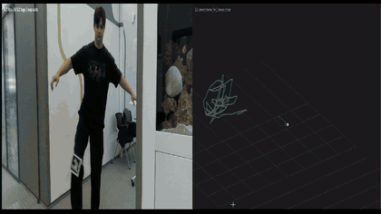
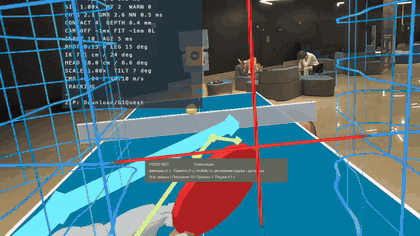
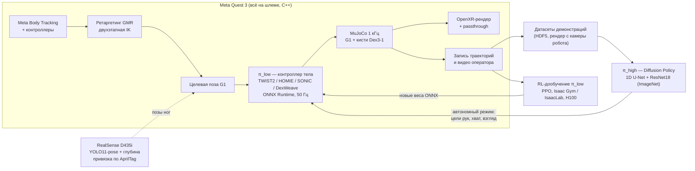
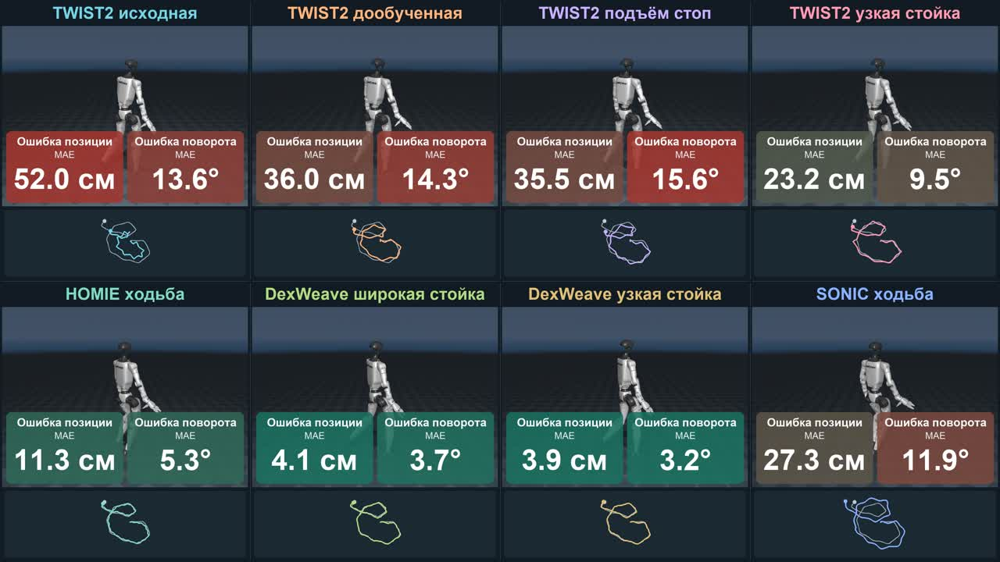

# Телеуправление гуманоидом через VR и обучение автономных политик по демонстрациям

Командный исследовательский проект, октябрь 2026. Оператор в шлеме
**Meta Quest 3** управляет всем телом гуманоида **Unitree G1** с кистями
Dex3-1 в физической симуляции **MuJoCo**. Симуляция и нейросетевые
контроллеры работают прямо на шлеме, без компьютера. Записанные демонстрации
используются для обучения автономной визуальной политики (Diffusion Policy).

> Это форк репозитория команды [emb-ai/FURRY](https://github.com/emb-ai/FURRY).
> Здесь только новое описание; код, данные и история коммитов совпадают с
> оригиналом. Мой вклад — в разделе [«Моя роль»](#моя-роль).

| Захват чашки в VR | Настольный теннис в VR |
|---|---|
|  |  |

Видео: [итоговый ролик, 1:29](https://github.com/emb-ai/FURRY/blob/main/docs/demo/2026-10-16/furry-final-montage.mp4) ·
[сравнение восьми контроллеров, 0:26](https://github.com/emb-ai/FURRY/blob/main/docs/demo/2026-10-16/policies-comparison.mp4)

## Задача

Для обучения гуманоидов нужны демонстрации движений всего тела. Обычно их
снимают дорогими системами захвата движения (mocap) или костюмами с
десятками датчиков. Вопрос проекта: **насколько далеко можно уйти с
разреженными наблюдениями**, которые даёт обычный VR-шлем? Это положение
головы, контроллеров или кистей рук и оценка позы тела от Meta Body Tracking,
у которой ноги лишь достраиваются.

Что требовалось сделать:

1. **Телеуправление.** Перенести позу человека на робота с другими
   пропорциями (ретаргетинг) и удерживать робота в равновесии обученным
   контроллером всего тела в реальном времени на мобильном процессоре шлема.
2. **Сбор данных.** Записывать демонстрации задач манипуляции: перенос
   чашки, подъём двух предметов, Push-T.
3. **Автономия.** Обучить по этим записям политику, которая решает задачу
   по изображению с камеры робота без оператора.
4. **Ноги.** Улучшить отслеживание ног, которое шлем видит хуже всего:
   внешняя RGB-D камера и дообучение контроллера с подкреплением.

Ограничения: только симуляция, реальный робот вне рамок проекта.

## Схема решения

Двухуровневая архитектура:

- **π_low** — низкоуровневый контроллер тела. Получает целевую позу и выдаёт
  целевые углы 29 суставов, которые отрабатывает PD-регулятор. Подключено
  четыре семейства: TWIST2 (трекер движений, обученный RL), HOMIE v2 (NVIDIA
  GR00T: RL управляет ногами и корпусом, руки идут за ретаргетингом), SONIC
  (нейросетевой планировщик походки) и DexWeave (собственная реконструкция
  статьи без авторского кода).
- **π_high** — высокоуровневая визуальная политика. Смотрит на изображение
  224×224 с камеры робота и выдаёт ту же команду, что дал бы оператор:
  35 значений целевых положений трекеров, 2 хвата и поворот камеры. Поэтому
  данные, собранные человеком, напрямую становятся обучающей выборкой.

## Методы

| Блок | Что использовано |
|---|---|
| Рантайм на шлеме | C++, OpenXR, MuJoCo, ONNX Runtime, OpenGL ES, Android NDK. Физика 1 кГц, контроллер 50 Гц в одном потоке CPU |
| Ретаргетинг | Порт GMR (General Motion Retargeting) с Python на C++: двухэтапная IK, якобианы SE(3), демпфирование Левенберга – Марквардта, box-QP MuJoCo вместо DAQP. Сверен с оригиналом на синтетических данных |
| Контроллеры тела | TWIST2, HOMIE v2, SONIC VR3; проверка весов по SHA256, переключение из меню в шлеме |
| RL-дообучение | PPO на данных Quest: дообучение TWIST2, узкая стойка, штраф `lift_follow` за касание пола при поднятой цели стопы. DexWeave: transformer с анатомическими токенами, IsaacLab + RSL-RL, 6 GPU, 24 576 сред, ≈1,2 млрд переходов |
| Внешняя камера | RealSense D435i → YOLO11s-pose (COCO-17) → 3D по глубине → фильтр One-Euro и ограничения длин костей → перевод в систему координат Quest по маркеру AprilTag 36h11. RTMW3D проверен и отклонён: глубина почти не информативна |
| Имитационное обучение | Diffusion Policy: 1D U-Net (81M параметров), энкодер ResNet18 (ImageNet), горизонт 16, DDIM 20 шагов, EMA, cosine LR, аугментации crop/color. Для сравнения: ACT, BC-RNN, малый FiLM-денойзер |
| Оценка | Настольная копия цикла шлема (QuestSim), закрытый контур на новых случайных раскладках, автоматические критерии успеха и падения |

## Результаты

### Автономные визуальные политики (π_high)

| Задача | Данные | Лучшая модель | Успех на новых раскладках |
|---|---|---|---|
| Подъём двух предметов (левой и правой рукой одновременно) | 69 демонстраций, 23 192 кадра | U-Net + ResNet18 ImageNet, 50k шагов | **82 / 200 (41 %)**, 0 падений, медиана 11 с (как у оператора) |
| Перенос чашки на цель | 93 демонстрации | U-Net + ResNet18 ImageNet, 75k шагов | **23 / 50 (46 %)**, 0 падений, медиана 9,6 с |

Что выяснилось по ходу:

- **Предобученный энкодер решает.** Без ImageNet лучшая модель на двух
  предметах даёт 15,5 %, на чашке 1/54.
- **Ёмкость важнее длины обучения.** Малый FiLM-денойзер (0,3M параметров)
  не решил ни одной попытки даже за 100k шагов; стандартный U-Net решает.
- **Узкое место чашки — захват:** поднятую чашку модель доносит до цели в
  68 % случаев.
- На 40–93 демонстрациях после 50–75k шагов начинается переобучение.
- Политики только по состоянию симулятора (BC-RNN, Diffusion) на чашке
  дали 0/10, ACT — не более 2/10.

Отчёты: [два предмета](training/quest_bimanual_pi_high/report.md),
[чашка](training/quest_cup_pi_high/report.md).

### Контроллеры тела (π_low)

Все восемь контроллеров получили одну и ту же запись оператора (20 с,
повороты вправо). Метрика — средняя ошибка положения и поворота таза
относительно референса, без подгонки после прогона:

| Контроллер | Ошибка XY, см | Ошибка поворота, ° |
|---|---:|---:|
| TWIST2, исходный | 52,0 | 13,6 |
| TWIST2, дообученный на данных Quest | 36,0 | 14,3 |
| TWIST2, узкая стойка (RL) | 23,2 | 9,5 |
| SONIC VR3 | 27,3 | 11,9 |
| HOMIE v2 | 11,3 | 5,3 |
| **DexWeave, узкая стойка** | **3,9** | **3,2** |

Это один диагностический фрагмент, а не общая оценка качества походки
([протокол](docs/demo/2026-10-16/policy-comparison.md)).

### Ноги и производительность

- **RL-дообучение по ногам с камеры.** Скольжение опорной стопы ниже на
  30–50 %, уход корня 0,7–0,8 м вместо 2,6–3,2 м. Штраф `lift_follow`
  сократил долю времени, когда цель держит стопу поднятой, а робот стоит
  на полу, с 51 % до 24 %
  ([v2](training/quest_contact_clearance/camera_v2_report.md),
  [v3](training/quest_contact_clearance/camera_v3_report.md)).
- **Производительность на шлеме.** Шаг физики и контроллера — медиана
  6,47 мс, p95 7,46 мс при бюджете 10 мс; ретаргетинг 0,40 мс. Рендер 72 FPS
  с passthrough.
- **Датасеты.** 15 минут принятых движений для обучения контроллеров;
  34 эпизода с ногами от камеры (35 минут); более 200 демонстраций
  манипуляции.

### Что не получилось

Устойчивая ходьба по командам из шлема, точное отслеживание ног внешней
камерой (мешает шум глубины) и сборка кубика Рубика остались открытыми
задачами. Кубик в итоговом ролике — анонс, а не решённая задача.

## Моя роль

Команда из четырёх человек. Я отвечал за обучение по демонстрациям,
внешнюю камеру и инфраструктуру обучения:

- **Визуальная политика π_high:** экспорт данных, Diffusion Policy (U-Net,
  ResNet18 ImageNet), настольная копия цикла шлема QuestSim, оценка в
  закрытом контуре и автоматические критерии успеха задач. Подъём двух
  предметов: с 0 % у исходного денойзера до 41 %; перенос чашки: 46 %.
- **Внешняя камера:** привязка RealSense к системе координат Quest по
  AprilTag, слияние скелета камеры со скелетом Meta на шлеме (C++),
  датасеты ног с камеры.
- **RL-дообучение контроллера TWIST2** по ногам с камеры, штраф за касание
  пола (`lift_follow`), анализ причин спотыканий.
- **Инфраструктура:** изолированное окружение для обучения на общем
  сервере с 8×H100 (Isaac Gym, PhysX).

Основной код: [`prototypes/quest_g1/g1_sim/`](prototypes/quest_g1/g1_sim/),
[`training/`](training/), [`skeleton/`](skeleton/).

Рантайм на шлеме, порт GMR, интеграцию HOMIE, SONIC и DexWeave делал
[AnanasClassic](https://github.com/AnanasClassic); базовый скелет камеры и
часть демонстраций — [Yeetmq](https://github.com/Yeetmq); CI и инструменты —
[Penchekrak](https://github.com/Penchekrak).

## Структура репозитория

| Папка | Содержимое |
|---|---|
| [`prototypes/quest_g1/android/`](prototypes/quest_g1/android/) | Приложение для Quest 3: C++, OpenXR, MuJoCo, ONNX, GMR |
| [`prototypes/quest_g1/g1_sim/`](prototypes/quest_g1/g1_sim/) | Настольная симуляция, задачи, Diffusion Policy, QuestSim, оценка |
| [`prototypes/quest_g1/training/`](prototypes/quest_g1/training/), [`training/`](training/) | RL-дообучение контроллеров, DexWeave, обучение π_high, сервер |
| [`skeleton/`](skeleton/) | Внешняя камера: YOLO-pose, глубина, AprilTag |
| [`datasets/`](datasets/) | Опубликованные датасеты Quest (Git LFS) |
| [`docs/`](docs/) | База знаний, обзор литературы, исследовательские отчёты |

Запуск и сборка описаны в [`prototypes/quest_g1/README.md`](prototypes/quest_g1/README.md)
и [`docs/Getting-Started.md`](docs/Getting-Started.md).

## Основа и лицензия

Проект начинался с [TWIST2](https://arxiv.org/abs/2511.02832)
([код](https://github.com/amazon-far/TWIST2)). Код проекта распространяется по
лицензии [Apache-2.0](LICENSE); сторонние модели и данные — по своим лицензиям.
